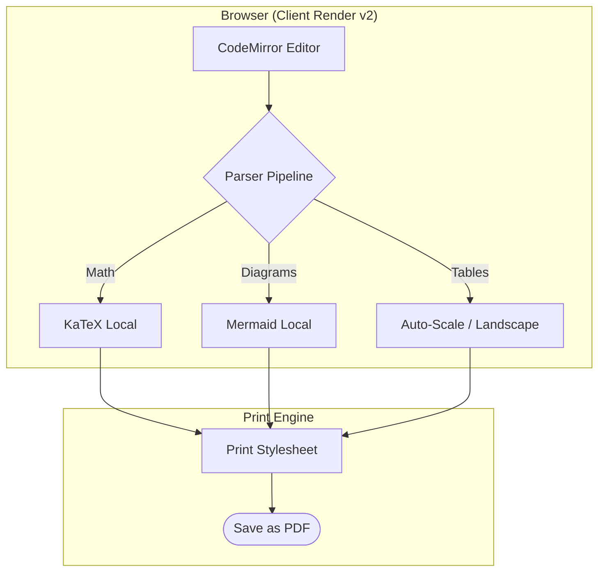
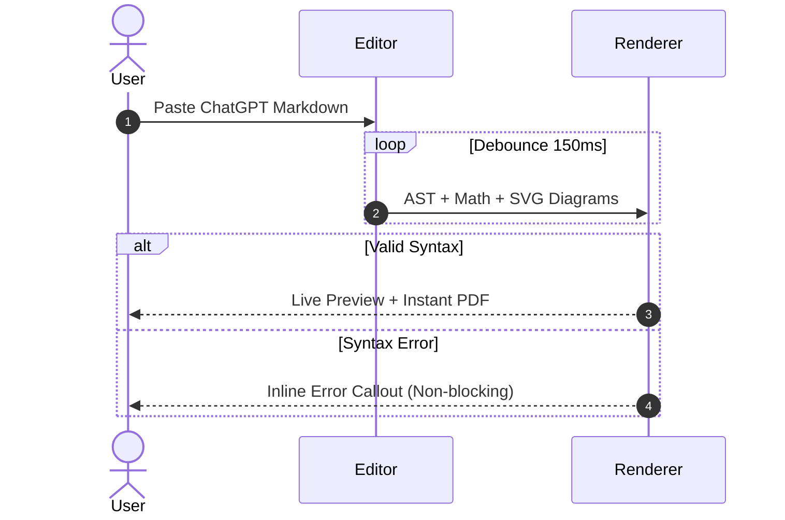

# Complex Mermaid + Broken Syntax Isolation

## 1. Complex Flowchart with Subgraphs & Styling


## 2. Sequence Diagram with Loops & Alt Blocks


## 3. Intentionally Broken Mermaid Block (Must Not Break Diagrams 1 & 2)
```mermaid
graph TD
    A[Start] --->|broken arrow syntax| ???
    B((Unclosed node
    subgraph
```
