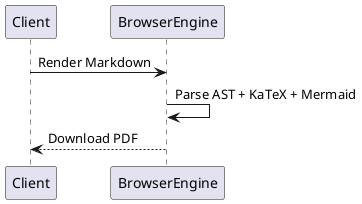
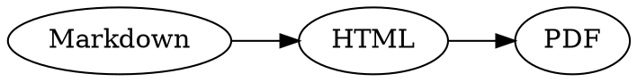

# Non-Mermaid Diagram Types (PlantUML & Graphviz)

Verify how v2 handles or gracefully degrades legacy v1 Kroki diagram blocks when external calls are disabled.

## PlantUML Sequence

## Graphviz DOT

